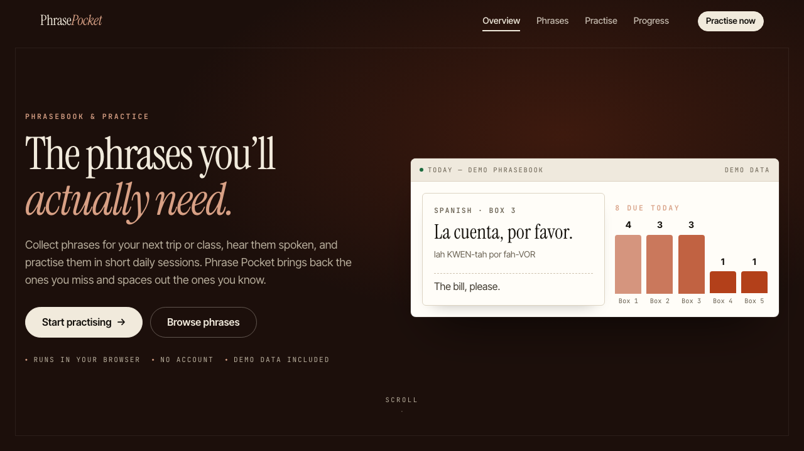
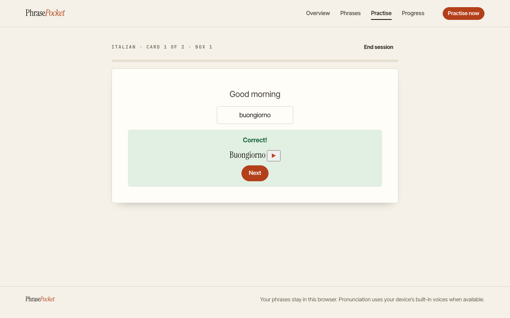
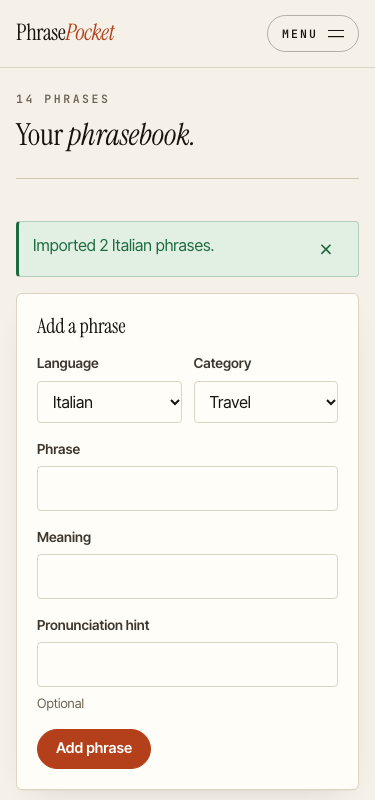

# Phrase Pocket

A phrasebook with practice built in: collect phrases per language, hear them with your device’s voices, and practise in short sessions scheduled with Leitner-box spaced repetition. Typed answers forgive missing accents and point out small typos.

**Live demo:** [https://phrase-pocket.vercel.app/](https://phrase-pocket.vercel.app/) — runs entirely in your browser; demo data is fictional and labelled.



| Practice | Mobile |
| --- | --- |
|  |  |

## Run it

```bash
npm install
npm run dev        # http://localhost:5219
npm test
npm run build
npm run test:e2e   # Playwright smoke test (npm run e2e:install once if Chromium is missing)
```

## Main workflow

1. The app opens with twelve labelled **demo phrases** in Spanish, French and Japanese, with some review history. **Phrases → Clear demo phrases** removes them.
2. **Phrases** → add a phrase with its meaning, pronunciation hint and category, or paste a list of `phrase = meaning` lines (tabs also work). Duplicates are refused even if accents differ. Filter by language, category or favourites; ▶ plays the phrase when a voice is available.
3. **Practise** → choose a language and mode. *Speaking* shows the meaning and you type the phrase; *reading* shows the phrase and you reveal the meaning and grade yourself. Sessions take up to 15 due phrases, lowest box first; **extra practice** ignores due dates.
4. **Progress** → due today and tomorrow, 14-day accuracy, streak, phrases per box, and reviews per day (right vs missed) with details on hover or focus.

## Rules

- Five Leitner boxes with intervals of 1, 2, 4, 8 and 16 days. A right answer moves a phrase up one box; a miss sends it to box 1, due tomorrow. New phrases are due today.
- Answer checking ignores case, spacing and punctuation (including ¿ and ¡). Same letters but missing accents = correct with a note; up to one edit per eight characters = “nearly” (still counted); anything else = not quite.
- The streak counts consecutive days with at least one review, ending today or yesterday.

## Design

Shared editorial system: Instrument Serif display type for phrases, Inter Tight interface text, mono labels, a large centred practice card with colour-coded feedback, an ink hero whose preview is a real card and box chart, and a warm paper workspace. Motion is disabled under `prefers-reduced-motion`.

## Tests

- `src/lib/phrases.test.ts` — Leitner moves and due dates, queue order, box counts, normalisation, edit distance, answer grading, accuracy and streak, validation with accent-insensitive duplicates, bulk parsing.
- `src/App.test.tsx` — a recall session with “I don’t know”, accent-tolerant marking to completion, adding with duplicate refusal and bulk import, filters, progress charts.
- `e2e/smoke.spec.ts` — landing, bulk import, typed practice to completion with reload persistence, progress, plus 375px layout checks.

## Limitations

- Voices depend on what your device has installed; some languages may be silent.
- No audio recording or speech recognition.
- Typing non-Latin scripts depends on your keyboard; recognition mode works for any script.

## Future improvements

- Example sentences per phrase; sharing a deck as a file.

## Licence

MIT — see [LICENSE](LICENSE).
